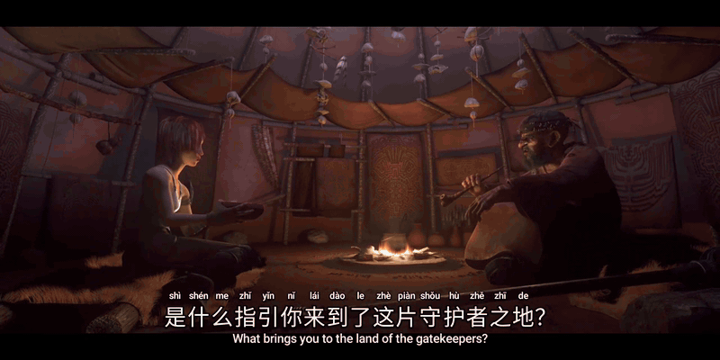
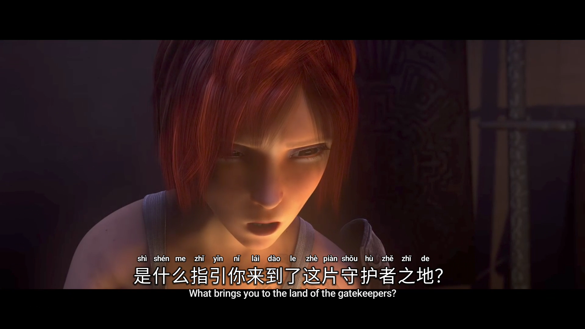
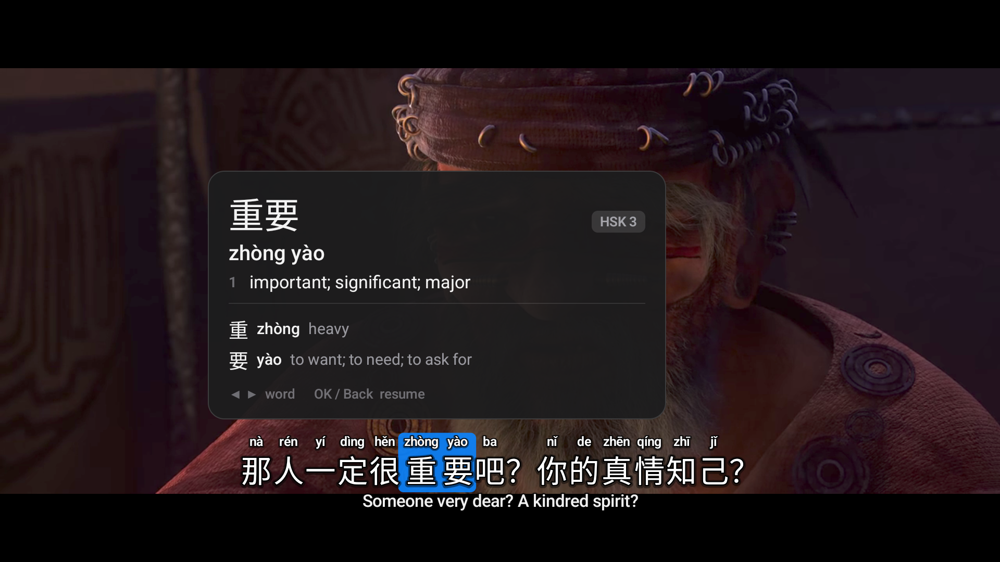
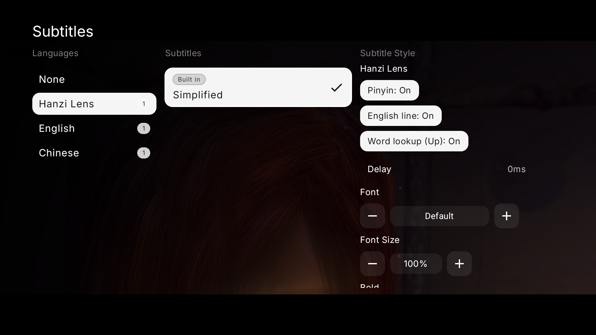

# Hanzi Lens fork of NuvioTV

An unofficial fork of [NuvioTV](https://github.com/NuvioMedia/NuvioTV) that adds Chinese-learning subtitles to the player. It is not affiliated with or endorsed by the Nuvio project; the Nuvio name and logo belong to their owners. Licensed GPL-3.0 like the original (see `LICENSE`).

## What it adds

- **Pinyin over Chinese subtitles.** Chinese text subtitles (a track in the file, or an add-on SRT/VTT) are drawn with tone-marked pinyin above every character.
- **English line underneath.** If the file also has an English text track, its line is shown under the Chinese one. Bilingual cues show their non-Chinese lines there too.
- **Word lookup with the remote.** While a Chinese line is on screen and the controls are hidden:
  - **Up**: pause and select the first word, showing its dictionary card
  - **Left / Right**: previous / next word
  - **OK, Back, Play/Pause or Down**: close the card and resume
- **A "Hanzi Lens" entry in the subtitle menu.** Pick a Chinese track under *Hanzi Lens* to turn it on, or under *Chinese* for the plain track. Three switches (Pinyin, English line, Word lookup) sit at the top of the style column. The choice and the switches are remembered per show or film.

Everything runs on the device from the subtitle the player is already decoding: no server and no extra download.

| Subtitles | Word lookup | Subtitle menu |
| --- | --- | --- |
|  |  |  |

The pictures are recorded from this build on an Android TV emulator playing a clip of *Sintel* (© copyright Blender Foundation | durian.blender.org, [CC BY 3.0](https://creativecommons.org/licenses/by/3.0/)) with its official Chinese and English subtitles.

## Changes from upstream

Made in November 2026 on top of upstream commit `3ff5e2b`.

- New: `app/src/main/java/com/nuvio/tv/hanzi/` — dictionary (`HanziDictionary`), state (`HanziLens`), per-show settings (`HanziSettings`), English second track (`HanziSecondTrack`), drawing and the lookup card (`HanziSubtitleOverlay`)
- New: `app/src/main/assets/hanzi/` — dictionary data, built by `tools/build-hanzi-assets.js`
- Modified: `StyledSubtitlePresenter` (hands Chinese cues to Hanzi Lens), `PlayerRuntimeController` and `PlayerRuntimeControllerInitialization` (own the state, add the second text renderer), `PlayerScreen` (overlay and remote keys), `SubtitleSelectionOverlay` (menu entry and switches)

## Build

    echo "sdk.dir=<Android SDK path>" > local.properties
    ./gradlew :app:assembleFullDebug

APKs land in `app/build/outputs/apk/full/debug/`. The debug build installs as a separate app (`com.nuviodebug.com`) next to official Nuvio and is signed with your local debug key, so it cannot update, or be updated by, official builds.

## Install on Fire TV / Android TV

Enable Developer Options → ADB debugging on the device, then:

    tools/firetv-install.sh <device-ip>:5555

The script installs the 32-bit build (most Fire TV sticks run 32-bit apps) and compiles it on the device for a faster start. For a 64-bit device install `app-full-arm64-v8a-debug.apk` with `adb install -r` instead.

## Known limits

- Works with the default (ExoPlayer) engine and text subtitles. Styled ASS tracks drawn by libass, image subtitles and the mpv engine are not annotated.
- QR sign-in and account sync need Nuvio's backend values in the gitignored `local.properties` (`NUVIO_SUPABASE_URL`, `NUVIO_SUPABASE_ANON_KEY`, `NUVIO_SUPABASE_FALLBACK_URL`). A build without them can only "Continue without account".

## Dictionary data

`app/src/main/assets/hanzi/*.bin` is generated from [CC-CEDICT](https://www.mdbg.net/chinese/dictionary?page=cc-cedict) ([CC BY-SA 4.0](https://creativecommons.org/licenses/by-sa/4.0/)), the [Unicode Unihan database](https://www.unicode.org/charts/unihan.html) (Unicode License v3), [jieba](https://github.com/fxsjy/jieba) word frequencies (MIT) and [complete-hsk-vocabulary](https://github.com/drkameleon/complete-hsk-vocabulary) (MIT). The data is selected and re-encoded from those sources and stays under CC BY-SA 4.0.
